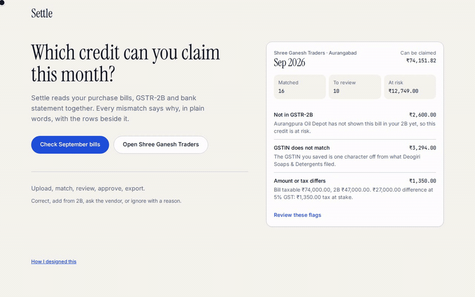

# Settle



See which GST input credit you can claim this month, and what to fix.

Live demo: https://settle-shreeraj-narwade.vercel.app/

## Run

```bash
npm install && npm run dev
```

Then open http://localhost:8080. Choose **Check September bills**, or **Open Shree Ganesh Traders** to skip straight to the matched month. Review a flag, correct a GSTIN, mark a vendor follow-up, approve the period, and export.

Settle is a client-only prototype. Nothing is uploaded to a server, and there is no account, database, or API. The books are for one fictional business, Shree Ganesh Traders of Aurangabad, closing September 2026. The GSTINs, invoice numbers, and amounts are made up. Every mismatch explains itself, with the rows side by side.

## License

[MIT](LICENSE)
